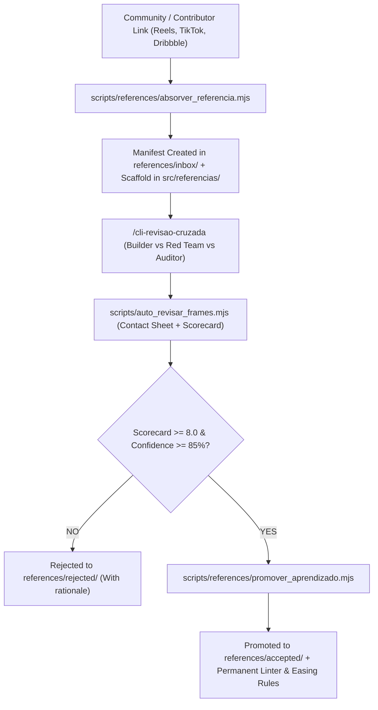

# Vibe Design Studio 🎨🎬

> **Headless Motion Studio & Self-Evolving Video Knowledge Engine for AI Agents.**  
> Built for [Google Antigravity](https://github.com/google/antigravity), [Claude Code](https://github.com/anthropics/claude-code), [Cursor](https://www.cursor.com), and [Remotion](https://www.remotion.dev).

[](LICENSE)
[](https://www.remotion.dev)
[](https://www.typescriptlang.org)
[](https://react.dev)
[](#agent-integration)
[](#zero-media-bloat-philosophy)

---

## 🛑 The Problem: "AI Slop" in Video

When developers ask LLMs to generate video with Remotion or code, models default to amateur, low-effort patterns:

- ❌ Centered, all-caps text (`UPPERCASE`) floating on blank screens.
- ❌ Generic purple/cyan gradients with zero noise, depth, or tactile texture.
- ❌ Stiff linear transitions (`opacity: 0 -> 1`) with zero physical inertia or spring physics.
- ❌ Ear-splitting audio foley (impacts $> 0.45$ volume drowning the narrator).
- ❌ Blind completion: agents declare "done" without inspecting frames for overlaps or dead time.

**Vibe Design Studio replaces naive prompting with a deterministic Headless Code Studio enforced by linters and an automated visual audit loop.**

---

## 💡 Zero Media Bloat Philosophy

This repository contains **zero binary media bloat** (no gigabytes of MP3s, MP4s, or heavy video files).
Instead, it stores **pure codified knowledge**:
- **Mathematical Easing Curves (`measured_eases.ts`):** Calibrated Bézier and spring math.
- **Physical Design System (`kit.tsx`, `AppleCameraRig.tsx`):** 3D perspective, parallax drift, negative kerning.
- **Static Anti-Slop Linters (`lint-motion-slop.mjs`):** Automated AST and regex rule enforcement.
- **Automated Frame Quality Audit (`auto_revisar_frames.mjs`):** Keyframe stills and contact sheets rated on a strict $\ge 8.0/10$ scale.
- **Visual References Knowledge Corpus (`references/`):** Deconstructions and schemas learned from the community.

You plug your own voiceover audio or generate it via Edge-TTS / Whisper on the fly.

---

## 🧠 Self-Evolving Engine (The Learning Loop)

Vibe Design Studio compounds visual intelligence over time by ingesting new video references, stress-testing them through cross-model debate, and crystallizing them into the repository:



### 🤝 Submitting a Reference
Anyone in the community can submit inspiring video techniques:
1. Open a **[GitHub Issue: Submit a Viral Video Reference](https://github.com/Gabrielrtads/Vibe Design Studio/issues/new?template=visual-reference.yml)**.
2. Provide the video URL, timestamp range, and key elements (spring physics, 3D tilt, typography, sound).
3. The engine parses the issue, generates a Remotion prototype, runs the cross-model review, and submits a Pull Request when approved!

---

## ✨ Core Tools & Capabilities

### 1. 🛡️ Static Anti-Slop Linter (`lint-motion-slop.mjs`)
Automated gatekeeper that rejects renders or PRs if amateur patterns are detected:
- **Audio Ceiling:** Prohibits foley impacts with volume $> 0.45$.
- **Anti-Deck Gate:** Blocks slide-deck layouts and banned marketing clichés.
- **Physics Enforcement:** Verifies that all movements use physical `spring()` or measured Bézier curves (`EASE.*`).

### 2. 👁️ Automated Frame Review & Contact Sheet (`auto_revisar_frames.mjs`)
Renders keyframe stills, compiles a consolidated **Contact Sheet (`contact-sheet.jpg`)**, hunts for dead frames, and issues an objective scorecard:

```json
{
  "compositionId": "FlowMotionMaster",
  "totalFrames": 825,
  "fps": 30,
  "durationSeconds": "27.5",
  "mediaGeral": 9.0,
  "status": "APROVADO (PADRÃO ESTÚDIO >= 8/10)",
  "frames": [
    { "frame": 117, "time": "3.90s", "score": 9.0, "flags": ["Ritmo e densidade visual aprovados"] },
    { "frame": 351, "time": "11.70s", "score": 9.0, "flags": ["Ritmo e densidade visual aprovados"] }
  ]
}
```

### 3. 🎙️ Millisecond Word-by-Word Alignment (`transcrever-palavras.mjs`)
Leverages Whisper (`words.json`) to extract exact `start` and `end` timestamps for every spoken word, enabling tight kinetic typography and synced micro-interactions.

---

## 🚀 Quickstart

### 1. Clone & Install
```bash
git clone https://github.com/Gabrielrtads/Vibe Design Studio.git
cd Vibe Design Studio
pnpm install
```

### 2. Audit Code Against Slop
```bash
node scripts/lint-motion-slop.mjs src/FlowMotionMaster.tsx
```

### 3. Run Automated Frame Review
```bash
node scripts/auto_revisar_frames.mjs FlowMotionMaster --stills 6
```
Inspect `out/contact-sheet.jpg` and `out/review_scorecard.json` (Score $\ge 8.0/10$).

### 4. Ingest a New Visual Reference
```bash
node scripts/references/absorver_referencia.mjs --url "https://instagram.com/reel/..." --title "3D Perspective Card Tilt" --author "@creator"
```

---

## 🤖 Agent Integration

Vibe Design Studio includes a native `SKILL.md` compliant with [Google Antigravity](https://github.com/google/antigravity), [Claude Code](https://github.com/anthropics/claude-code), and [Codex](https://github.com/openai/codex).

### Installing as a Skill
```bash
git clone https://github.com/Gabrielrtads/Vibe Design Studio.git .agents/skills/vibe-design-studio
```

### Recommended Multi-Agent Role Division
- **Infrastructure Agents (Gemini / Terminal):** Manage TTS audio generation, Whisper alignment, headless Chromium rendering, and asset delivery.
- **Creative / Motion Agents (Claude):** Choreograph `spring()` curves, CSS 3D transforms, optical typography, and micro-interactions.

---

## 📁 Repository Structure

```
Vibe Design Studio/
├── .github/
│   └── ISSUE_TEMPLATE/
│       └── visual-reference.yml       # Community reference submission form
├── schemas/
│   └── reference-manifest.schema.json # JSON schema for references
├── references/
│   ├── inbox/                         # Pending submissions
│   ├── accepted/                      # Approved reference manifests
│   ├── rejected/                      # Rejected references with rationale
│   └── evidence/                      # Keyframe stills & contact sheets
├── scripts/
│   ├── references/
│   │   ├── absorver_referencia.mjs    # Reference intake & scaffolding
│   │   └── promover_aprendizado.mjs   # Promotion gate (Score >= 8.0, Conf >= 85%)
│   ├── lint-motion-slop.mjs           # Anti-Slop AST/regex linter
│   ├── auto_revisar_frames.mjs        # Frame review & contact sheet builder
│   ├── produzir_video_bancada.mjs     # 1-Click production pipeline
│   └── transcrever-palavras.mjs       # Whisper word-level transcription
├── src/
│   ├── FlowMotionMaster.tsx           # Benchmark production composition
│   ├── AppleCameraRig.tsx             # Camera drift & organic inertia
│   ├── AppleKineticCards.tsx          # 3D perspective floating cards
│   ├── KineticWordCaption.tsx         # Synced word highlighting
│   ├── kit.tsx                        # Shared spring math & typography
│   ├── styles_kit.tsx                 # Shaders, sheens & glassmorphism
│   ├── measured_eases.ts              # Calibrated easing functions
│   ├── PBRStage3D.tsx                 # Three.js 3D stage
│   └── index.tsx                      # Remotion root entry
├── package.json
├── remotion.config.ts
├── tsconfig.json
├── SKILL.md
└── LICENSE
```

---

## 📜 License

[MIT](LICENSE) © 2026 [Gabriel Toledo](https://github.com/Gabrielrtads)
