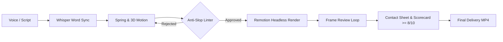

# AI-Video-Engine 🎬

> **Headless Motion Studio & Anti-Slop Video Generation Engine for AI Agents.**  
> Built for [Google Antigravity](https://github.com/google/antigravity), [Claude Code](https://github.com/anthropics/claude-code), [Cursor](https://www.cursor.com), and [Remotion](https://www.remotion.dev).

[](LICENSE)
[](https://www.remotion.dev)
[](https://www.typescriptlang.org)
[](https://react.dev)
[](#agent-integration)

---

## 🛑 The Problem: "AI Slop" in Video

When developers ask LLMs to generate video with Remotion or code, models default to amateur, low-effort patterns:

- ❌ Centered, all-caps text (`UPPERCASE`) floating on blank screens.
- ❌ Generic purple/cyan gradients with zero noise, depth, or tactile texture.
- ❌ Stiff linear transitions (`opacity: 0 -> 1`) with zero physical inertia or spring physics.
- ❌ Ear-splitting audio foley (impacts $> 0.5$ volume drowning the narrator).
- ❌ Blind completion: agents declare "done" without inspecting frames for overlaps or dead time.

**AI-Video-Engine replaces naive prompting with a deterministic Headless Code Studio enforced by linters and an automated visual audit loop.**

---

## ✨ Key Capabilities



### 1. 🛡️ Static Anti-Slop Linter (`lint-motion-slop.mjs`)
Automated gatekeeper that rejects pull requests or renders if amateur patterns are found:
- **Audio Ceiling:** Prohibits foley impacts with volume $> 0.45$.
- **Anti-Deck Gate:** Blocks slide-deck layouts and banned marketing clichés.
- **Physics Enforcement:** Verifies that all movements use physical `spring()` or measured Bézier curves (`EASE.*`).

### 2. 👁️ Automated Frame Review & Contact Sheet (`auto_revisar_frames.mjs`)
Never deliver blind video. The engine renders keyframe stills, compiles a consolidated **Contact Sheet (`contact-sheet.jpg`)**, hunts for dead frames, and issues an objective scorecard:

```json
{
  "compositionId": "FlowMotionMaster",
  "totalFrames": 825,
  "fps": 30,
  "durationSeconds": "27.5",
  "mediaGeral": 8.5,
  "status": "APROVADO (PADRÃO ESTÚDIO >= 8/10)",
  "frames": [
    { "frame": 117, "time": "3.90s", "score": 8.5, "flags": ["Ritmo e densidade visual aprovados"] },
    { "frame": 351, "time": "11.70s", "score": 9.0, "flags": ["Ritmo e densidade visual aprovados"] }
  ]
}
```

### 3. 🎙️ Millisecond Word-by-Word Alignment (`transcrever-palavras.mjs`)
Leverages Whisper (`words.json`) to extract exact `start` and `end` timestamps for every spoken word, enabling tight kinetic typography and synced micro-interactions.

### 4. 📐 Apple-Tier Design System (`kit.tsx` & `FlowMotionMaster.tsx`)
- **Camera Drift:** Subtle organic camera pan that prevents frozen frames.
- **Glassmorphism & Depth:** CSS 3D perspective layers, translucent backdrops, and metallic borders.
- **Negative Kerning:** Clean, editorial typography with optical sizing.

---

## 🚀 Quickstart

### 1. Clone & Install
```bash
git clone https://github.com/Gabrielrtads/AI-Video-Engine.git
cd AI-Video-Engine
pnpm install
```

### 2. Audit Code Against Slop
```bash
node scripts/lint-motion-slop.mjs src/FlowMotionMaster.tsx
```

### 3. Render Headless Video
```bash
pnpm exec remotion render FlowMotionMaster out/video.mp4 --codec=h264 --crf=16
```

### 4. Run Automated Frame Review
```bash
node scripts/auto_revisar_frames.mjs FlowMotionMaster --stills 6
```
Inspect `out/contact-sheet.jpg` and `out/review_scorecard.json`.

---

## 🤖 Agent Integration

AI-Video-Engine includes a native `SKILL.md` compliant with [Google Antigravity](https://github.com/google/antigravity), [Claude Code](https://github.com/anthropics/claude-code), and [Codex](https://github.com/openai/codex).

### Installing as a Skill
Drop this repository into your agent's skill directory:
```bash
# Antigravity / Claude Code
git clone https://github.com/Gabrielrtads/AI-Video-Engine.git .agents/skills/ai-video-engine
```

### Recommended Multi-Agent Role Division
- **Infrastructure Agents (Gemini / Terminal):** Manage TTS audio generation, Whisper alignment, headless Chromium rendering, and asset delivery.
- **Creative / Motion Agents (Claude):** Choreograph `spring()` curves, CSS 3D transforms, optical typography, and micro-interactions.

---

## 📁 Repository Structure

```
AI-Video-Engine/
├── scripts/
│   ├── lint-motion-slop.mjs       # Anti-Slop AST/regex linter
│   ├── auto_revisar_frames.mjs    # Frame review & contact sheet builder
│   ├── produzir_video_bancada.mjs # 1-Click production pipeline
│   └── transcrever-palavras.mjs   # Whisper word-level transcription
├── src/
│   ├── FlowMotionMaster.tsx       # Benchmark production composition
│   ├── AppleCameraRig.tsx         # Camera drift & organic inertia
│   ├── AppleKineticCards.tsx      # 3D perspective floating cards
│   ├── KineticWordCaption.tsx     # Synced word highlighting
│   ├── kit.tsx                    # Shared spring math & typography
│   ├── styles_kit.tsx             # Shaders, sheens & glassmorphism
│   ├── measured_eases.ts          # Calibrated easing functions
│   └── index.tsx                  # Remotion root entry
├── public/
│   └── audio/                     # Foley tracks & sample luxury voice
├── package.json
├── remotion.config.ts
├── tsconfig.json
├── SKILL.md
└── LICENSE
```

---

## 📜 License

[MIT](LICENSE) © 2026 [Gabriel Toledo](https://github.com/Gabrielrtads)
